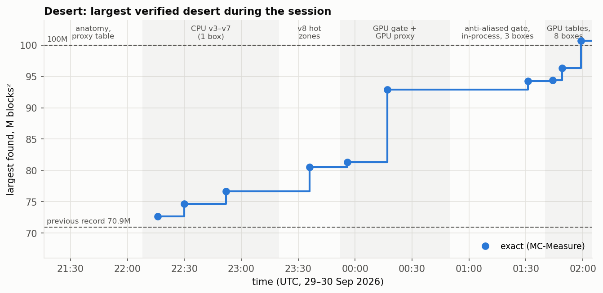
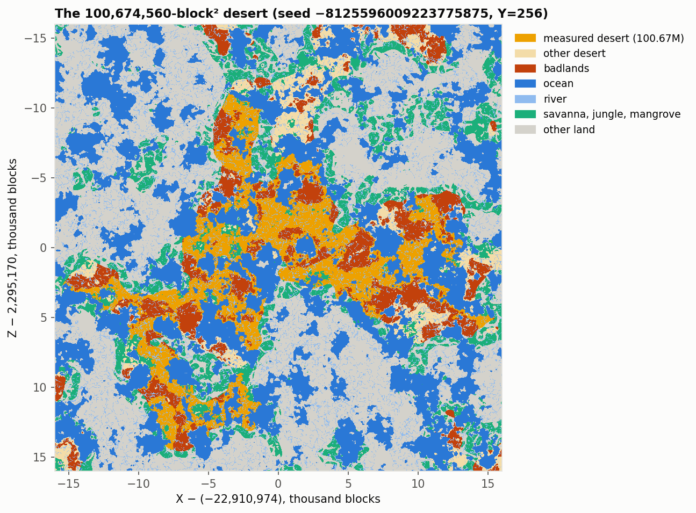
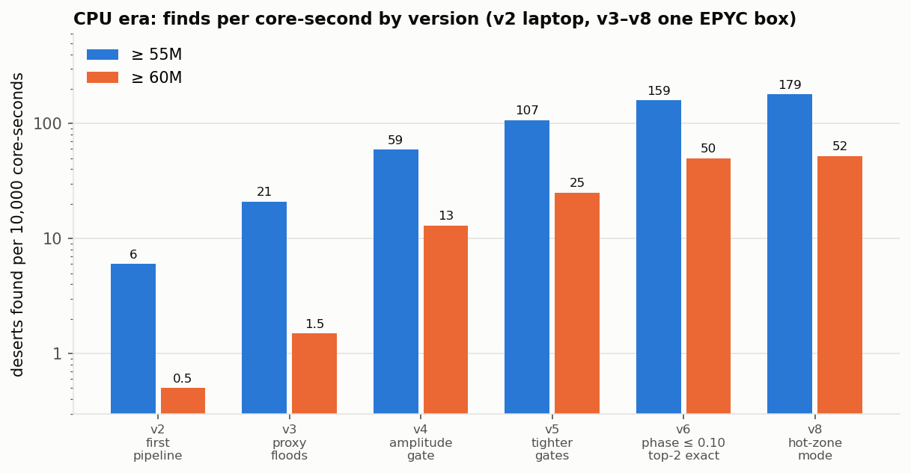
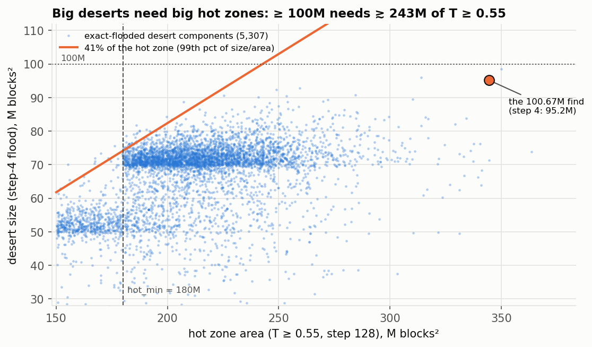
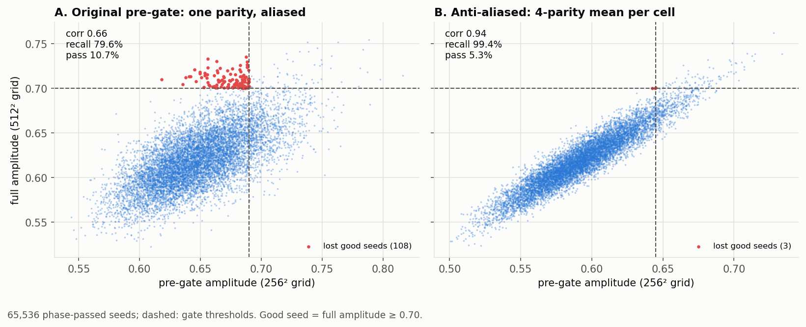
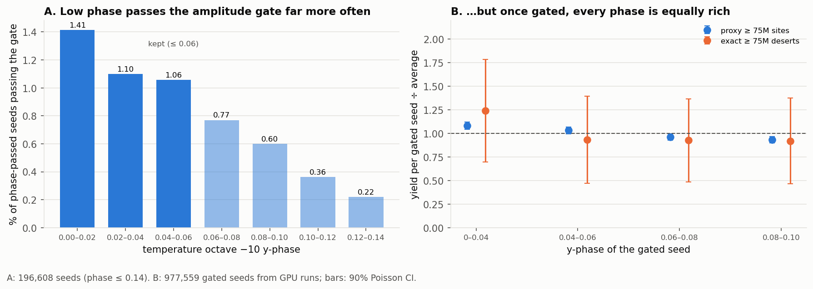
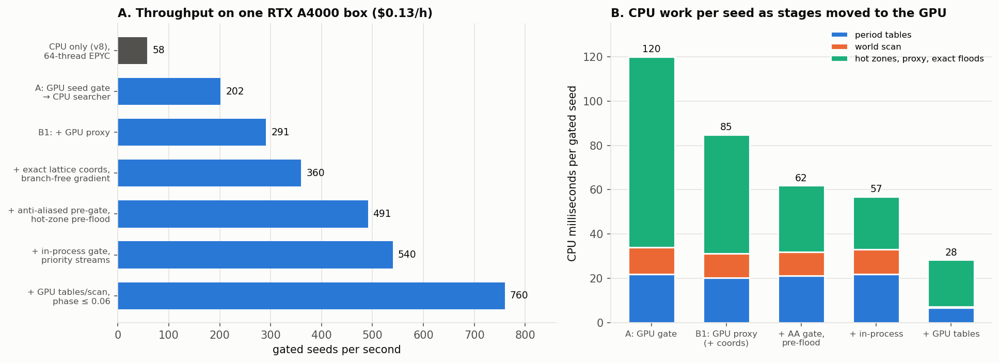
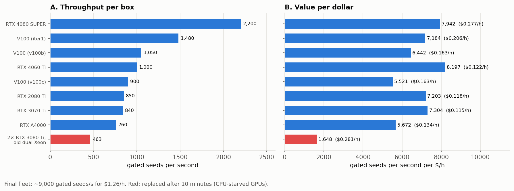
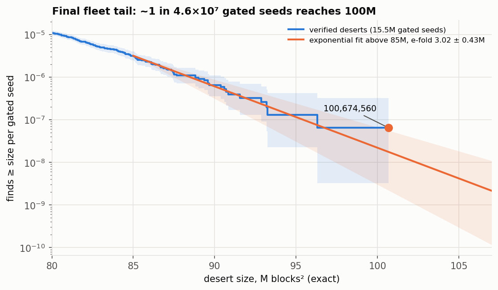

# From 70.9M to 100.7M: how the desert search evolved

The spreadsheet's desert record was **70,927,696 blocks²**. Work on deserts began at 21:16 UTC on
29 September, right after the dripstone search. Almost all of the next four hours went into building and
optimizing the pipeline on one to three rented boxes. At 01:40 UTC the final GPU build went out, and an
8-GPU fleet came online over the next 15 minutes. At 01:59, one of the first boxes running that build found
**100,674,560**.

Two kinds of progress got it there. Pipeline changes on the CPU raised the rate of ≥ 60M finds per
core-second ~100×, from 0.5 to 52 per 10k core-seconds. The GPU port then gave ~25× more per dollar, from
58 gated seeds/s at $0.20/h to ~9,000/s at $1.26/h for the full fleet.

This document follows the order things actually happened. Each step names the evidence that suggested it
and the measured effect. Times are UTC, 29–30 September 2026.

---

## 0. Starting point

The desert work started right after the dripstone search (repo `dripstone-search`)
reached 105M, so it inherited several pieces:

- a bit-exact climate sampler (`standalone.hpp`);
- the periodic side-A world scan;
- seed gates on the octave-0 y-phase and amplitude;
- the vast.ai fleet tooling.

The first question was measurement. Two builds of the measuring tool disagreed on the desert record. The
difference was MC-Measure's **river bridging**: a river is crossed, not counted, when the biome underneath
it would be desert. The standalone flood reproduces this rule, and at step 1 it matches MC-Measure cell for
cell on both the old record and the 100M find (`make check`).

## 1. Anatomy of a desert (21:16–22:05)

**Surface lookup without the tree.** At Y=256 the depth parameter is always negative, because the terrain
offset never exceeds ~1.4. Every surface biome therefore pays the same depth penalty, and the winner is
simply the depth-0 box containing (T, H, C, E, W). `SurfaceGrid` indexes those boxes on the grid of box
boundaries and falls back to the tree only on cut lines: 0 errors on 1M points.

**What bounds a desert.** Mapping the old record showed four limits:

- temperature (T ≥ 0.55);
- ocean (C < −0.19);
- badlands (erosion too low);
- savanna, jungle or mangrove (erosion too high).

The map of the final find below shows exactly this.

**The proxy.** Every one of those limits depends mostly on low-frequency noise, so I measured
P(desert | C octaves 0–2, E octaves 0–1) at 3.9M hot points (`tools/dfunc.cpp`). That gives a 40×40 table.
Evaluated on a 32-quart grid, it becomes a cheap desert-probability map: the **proxy flood**.

## 2. CPU pipeline, v2 → v8 (22:05–23:50)

v2 used the dripstone design with desert features: temperature gates and a logistic site score (AUC 0.87,
with erosion and continentalness weights), then step-8 floods. In 10 laptop-minutes the best was 57.6M. The
tail fit bent downward, putting 100M somewhere between months and never. The conclusion: **change the shape
of the tail, not just the speed.** I rented one 64-thread EPYC box as a testbed. Every version then ran for
~10 minutes on it and was scored by finds per core-second:

| Version | Change | Why | ≥ 55M / ≥ 60M per 10k core-s |
|---|---|---|---|
| v2 | T gates + site score + step-8 floods | dripstone recipe | 6 / 0.5 |
| v3 | proxy floods rank sites before exact floods | step-8 floods were ~95% of the cost | 21 / 1.5 (3.5×) |
| v4 | temperature-amplitude gate | per-seed best desert tracked smoothed octave-0 T amplitude | 59 / 13 (2.8×) |
| v5 | tighter phase and amplitude cuts | yield per core-s kept rising with both | 107 / 25 (1.8×) |
| v6 | phase ≤ 0.10, amp ≥ 0.70, exact floods only on the top-2 proxy components | seed bests nearly always came from proxy rank 1–2 | 159 / 50 (1.5×) |
| v8 | hot-zone mode (below) | zone study | 179 / 52, and 2.4× at ≥ 65M |

v3 beat the record within 5 minutes: **72,691,456** at 22:16, an hour after desert work began. v7's component-skip
code scanned the whole 1M-cell window after every proxy flood and briefly made things slower. Scanning only
the component's bounding box fixed it.

**The zone study → hot-zone mode.** To find what limits the *biggest* deserts, a study run logged features
for 2.17M hot zones. Hot-zone area (T ≥ 0.55) was by far the dominant predictor of proxy size. Badlands were
the largest fill loss (median 54% of a zone), and fill tracked regional mean E and C. So v8 floods each
site's hot zone at step 128 first and proxy-floods only zones ≥ 150M. The final fleet data confirm the
logic: no desert fills more than ~41% of its hot zone. A 100M desert therefore needs a hot zone of about
240M or more, and the one we found sat in a 345M zone.

At v8, the fitted tail put 100M at 28–305 box-hours on CPU. That was reachable, but it argued for a GPU.

## 3. GPU port (23:50–01:10)

The approach was to profile, move the biggest stage to the GPU, and repeat. All GPU stages have CPU
cross-checks (`check=1`, `gpucheck`, `gscancheck`).

1. **Seed gate on the GPU** (`tgate`), piped into the CPU searcher. The gate is embarrassingly parallel
   RNG and noise-table work. One $0.12/h RTX A4000 box went from 58 to **202 gated seeds/s**, 5–6× better
   per dollar than the CPU box. Proxy floods were now 70% of the CPU time.
2. **Proxy on the GPU.** Each big hot zone's bounding box is evaluated on a 32-quart grid. The GPU returns
   bitmaps, and the CPU labels components. Two kernel bugs cost 4×:
   - per-cell 64-bit divisions, replaced by lattice coordinates the CPU precomputes exactly;
   - a runtime-indexed gradient table that spilled to local memory, replaced by branch-free gradients.

   Throughput went from 133M to 554M cells/s, and the box to 360 seeds/s. **92,868,016** arrived at 00:17.
3. **A false negative.** A candidate logged at only 2.65M turned out, when its seed was inspected on a map, to sit in a huge desert. The exact
   flood had started on a component's edge cell, next to a detached pocket. The fix starts from interior
   cells nearest the centroid, with retries until the result is ≥ 0.6× the proxy.
4. **The gate had a hidden recall bug.** A calibration mode printed the cheap 256² pre-gate and the full
   512² amplitude for the same seeds. The pre-gate kept only **80%** of good seeds (correlation 0.66). It
   sampled every lattice cell at the same fractional offset, so the noise aliased before the blur. The fix
   averages all four half-lattice parities per cell, an anti-aliasing box filter. Merged corner tables keep
   that at 18 lookups per cell, and recall rose to 99.5% with half the pass rate.

   

5. **The CPU became the limit.** The container's quota was 30.7 cores despite `nproc` reporting 64.
   Profiling showed ~226 hot-zone floods per seed, of which only 7.5% were big. A step-256 pre-flood skips
   the small ones, and `hot_min` rose to 180M. The hot-zone plot shows that loses nothing near 100M. Result:
   +35% on the CPU-bound box, **491 seeds/s**.

## 4. Scaling out (01:00–02:00)

**Surprise: the testbed had a V100.** Its gate ran 2.4× faster than the A4000 even though vast lists it at
fewer FLOPS. The kernels are bound by shared memory, so SM count × clock predicts throughput (~9.6 seeds/s
per SM·GHz on every card tried). FLOPS does not.

**Two dead ends.** CUDA MPS let the gate's long kernels monopolize every SM and starve the proxy
(677 → 293 seeds/s). Running more threads than the CPU quota just got them throttled.

**One process per GPU.** The gate now runs inside the searcher, on a low-priority stream with one short
block per seed. The proxy and scan run on high-priority streams. A single zone's cells are split across many
blocks, since requests often carried just one zone and occupied one SM. GPU wait per seed fell from 11 ms
to 1 ms.

**Tables and scan on the GPU.** They were bit-exact with the CPU on every check and took CPU work from
57 ms to 28 ms per seed. The same calibration also showed that low y-phase seeds pass the amplitude gate far
more often, while every phase is equally rich once gated. Tightening phase from ≤ 0.10 to ≤ 0.06 gave +20%
gated seeds per GPU-second for free.

**The fleet.** I ranked offers by estimated seeds/s per dollar (SM·GHz for the GPU, CPU quota at
0.035 core-s/seed). Two problems came up:

- A 2× RTX 3080 Ti box on old dual Xeons ran at ~6× the CPU time per seed, and its GPUs idled. I replaced it
  after 10 minutes.
- A 2080 Ti's gate crashed at start: Turing allows only 64 KB of shared memory per block. It now falls back
  to half-height row blocks.

Final fleet: 8 boxes, ~9,000 gated seeds/s, $1.26/h.

**100,674,560** was verified at 01:59:51 by a V100 box, 20 minutes after the final build went out and a
few minutes after the eighth box came online. The step-4 flood had read it as 95.2M, so the verify threshold
of 80M left plenty of margin. MC-Measure on the laptop, started from a second point, gave the same number.

## 5. Lessons

- **Measure recall, not just speed.** The two biggest "free" wins were bugs in *what* was searched: the
  aliased pre-gate (−20% of good seeds) and edge-start floods. Both were caught by comparing a cheap
  estimate against the exact quantity on the same inputs.
- **Shape the tail.** Gates and hot-zone targeting moved the ≥ 60M rate 100× on the same hardware, before
  any GPU work.
- **Profile after every change.** The bottleneck moved from floods to proxy, gate, CPU quota, GPU
  time-slicing, and back to the gate. Each fix was chosen from the profile, not from the plan.
- **Hardware models need calibrating.** FLOPS, `nproc` and "64 cores" were all misleading. Measured seeds/s
  per box was the only reliable metric.

## Appendix: key numbers

| Quantity | Value |
|---|---|
| Start of desert work to the 100M find | 4 h 44 min (21:16 → 01:59 UTC), almost all of it development |
| Final build running before the find | 20 min (from 01:40 UTC; 3 boxes at first, 8 from ~01:55) |
| Gated seeds per ≥ 100M desert | ~4.6×10⁷ (2σ: 1.5×10⁷ – 3.3×10⁸), e-fold 3.0M above 85M |
| Verified deserts ≥ 75M / ≥ 90M | 222 / 15 (`results/desert_finds.jsonl`) |
| Gate pass rate | ~1 in 13,000 seeds (phase ≤ 0.06, pre-gate, amplitude ≥ 0.70) |
| CPU per gated seed, final | ~28 ms (hot-zone floods ~12, exact floods and bookkeeping ~9, tables/scan ~7) |
| Best single box | RTX 4080 SUPER, 2,200 seeds/s at $0.277/h |
